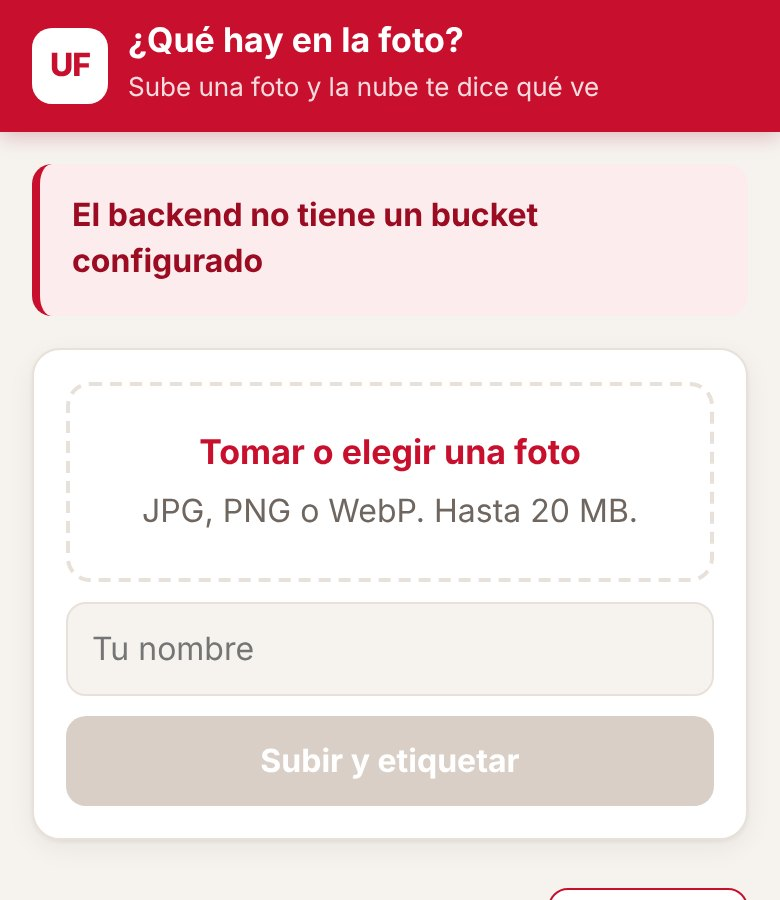
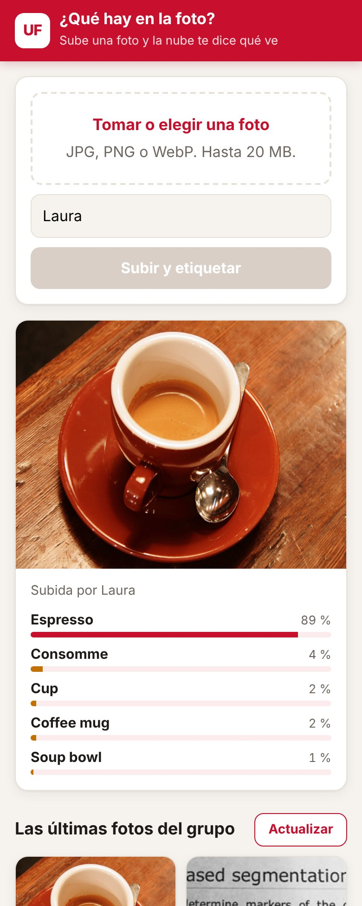
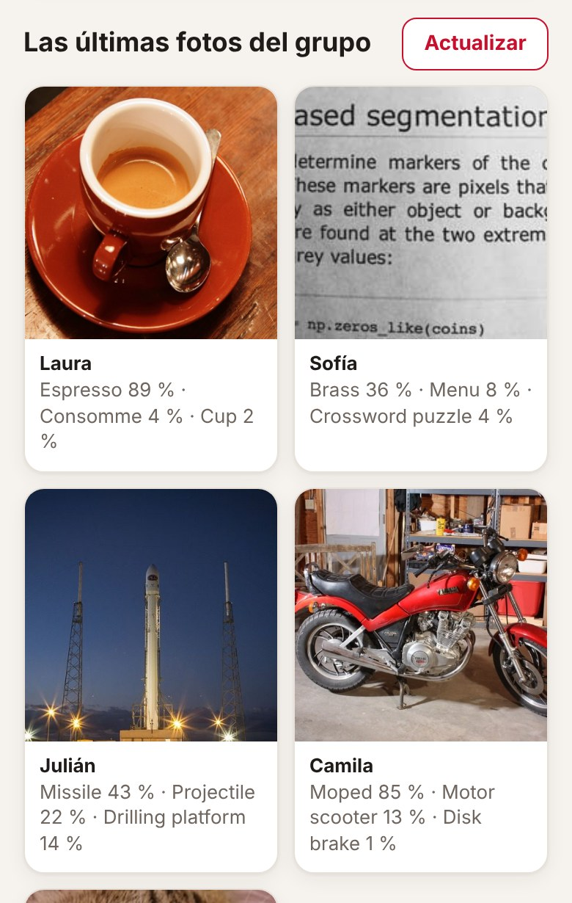
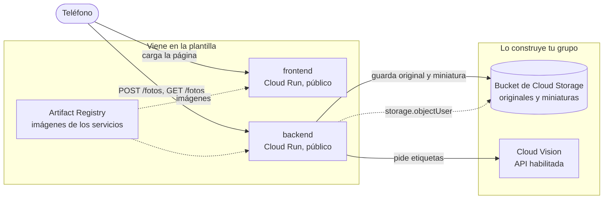
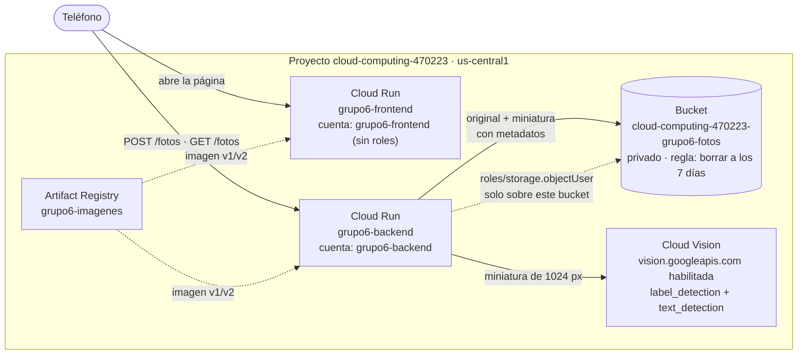

# ¿Qué hay en la foto?

Tomas una foto con el teléfono, la subes, y en un par de segundos la aplicación te dice qué ve en ella, con un porcentaje al lado de cada cosa. La foto queda guardada en un bucket de Cloud Storage y aparece en una galería con las últimas fotos del grupo. Quien reconoce lo que hay en la imagen no es código tuyo: es Cloud Vision, un modelo que Google ya entrenó y que se usa con una petición HTTP.

La plantilla trae las dos aplicaciones completas y la infraestructura del frontend y el backend. Tu grupo construye en Terraform el bucket, el permiso del backend sobre él y el acceso a Vision.

| Sin bucket todavía | Con etiquetas | La galería |
|---|---|---|
|  |  |  |

Las capturas salen de una prueba local: Cloud Storage simulado y, en lugar de Vision, un modelo de clasificación pequeño corriendo en el computador. Por eso las etiquetas de las capturas no son las de Vision; las reales las vas a ver cuando lo despliegues.

## Arquitectura al terminar la práctica



La flecha punteada es el único permiso de IAM que da tu grupo: la cuenta del backend puede crear, leer y listar objetos en ese bucket y en ningún otro. Para llamar a Vision no hace falta ningún rol: basta con que la API esté habilitada en el proyecto y con que el backend corra con una cuenta de servicio del mismo proyecto.

En la plantilla, la variable `BUCKET` del backend está vacía: responde que no tiene dónde guardar y no guarda nada. Es lo primero que vas a ver al desplegar.

## Estructura del repositorio

```
backend/main.py            API en Flask: recibe la foto, hace la miniatura, pide etiquetas y guarda en el bucket
backend/requirements.txt   Dependencias del backend con versión fija
backend/Dockerfile         Imagen del backend con gunicorn
frontend/index.html        La página: subir una foto, ver sus etiquetas y la galería del grupo
frontend/server.py         Servidor sin dependencias que inyecta BACKEND_URL en la página
frontend/Dockerfile        Imagen del frontend
infra/providers.tf         Versión de Terraform y del proveedor de Google
infra/variables.tf         Proyecto, prefijo, región e imágenes
infra/main.tf              APIs, registro, backend y frontend con sus cuentas
infra/outputs.tf           Ruta del registro y URL de los servicios
infra/terraform.tfvars.example   Ejemplo de valores; cópialo como terraform.tfvars
docs/api.md                Endpoints del backend y cómo se guardan las fotos
docs/capturas/             Capturas de la aplicación usadas en este README
.gitignore                 Deja por fuera el estado de Terraform, tus tfvars y __pycache__
```

## Cómo empezar

### Flujo de trabajo

1. Crea el repositorio de tu grupo con **Use this template** en GitHub.
2. Edita en VS Code o en github.dev (tecla `.` en la página del repositorio).
3. Haz commit y push desde el editor.
4. En Cloud Shell clonas la primera vez y traes los cambios con `git pull` después. Desde Cloud Shell nunca haces push.
5. Docker y Terraform se ejecutan siempre en Cloud Shell. La consola de Google Cloud es para mirar y diagnosticar, no para crear recursos.

### Primer despliegue

En Cloud Shell:

```bash
git clone https://github.com/<tu-usuario>/<tu-repositorio>.git
cd <tu-repositorio>/infra
cp terraform.tfvars.example terraform.tfvars
cloudshell edit terraform.tfvars
```

En `terraform.tfvars` pon el ID de tu proyecto y el prefijo del grupo, y ajusta las rutas de las imágenes a esos mismos valores. Este archivo vive solo en Cloud Shell: el `.gitignore` evita que llegue a GitHub.

El orden importa, porque las imágenes necesitan el registro y los servicios necesitan las imágenes:

```bash
# 1. Solo el registro (y las APIs de las que depende)
terraform init
terraform apply -target=google_artifact_registry_repository.registro

# 2. Las imágenes
REGISTRO=$(terraform output -raw registro)
gcloud auth configure-docker us-central1-docker.pkg.dev --quiet
cd ..
docker build -t $REGISTRO/backend:v1 backend
docker push $REGISTRO/backend:v1
docker build -t $REGISTRO/frontend:v1 frontend
docker push $REGISTRO/frontend:v1

# 3. Todo lo demás
cd infra
terraform apply
terraform output
```

Abre `url_frontend` en el teléfono. Si usas otra región, cambia `us-central1` en el comando de `gcloud auth configure-docker`, y ten en cuenta que la cuota gratuita de Cloud Storage solo aplica en `us-central1`, `us-east1` y `us-west1`.

Cuando cambies el código de un servicio, construye y sube la imagen con una etiqueta nueva (`v2`, `v3`...), actualízala en `terraform.tfvars` y vuelve a aplicar. Si subes otra vez la misma etiqueta, Terraform no ve ningún cambio y Cloud Run sigue con la versión anterior.

## Probar cada servicio con `docker run`

Antes de subir una imagen, pruébala en Cloud Shell. Para ver una página servida en Cloud Shell usa **Vista previa en la Web** y elige el puerto.

**Frontend.** No necesita credenciales:

```bash
docker run --rm -p 8080:8080 -e BACKEND_URL=https://<url-del-backend> $REGISTRO/frontend:v1
```

Abre la vista previa en el puerto 8080. Si no pasas `BACKEND_URL`, la página va a decir que no pudo hablar con el backend.

**Backend sin bucket.** El contenedor arranca aunque no tenga credenciales, y sin la variable `BUCKET` responde con un error claro:

```bash
docker run --rm -d --name backend -p 8081:8080 $REGISTRO/backend:v1
curl -i localhost:8081/fotos
docker logs backend
docker rm -f backend
```

Debe responder `503` con el error en JSON y una advertencia en los registros.

**Backend con bucket.** Cuando el bucket ya existe y la API de Vision está habilitada, puedes darle al contenedor tus propias credenciales:

```bash
gcloud auth application-default login
docker run --rm -d --name backend -p 8081:8080 \
  -e GOOGLE_CLOUD_PROJECT=<tu-proyecto> \
  -e BUCKET=<nombre-del-bucket> \
  -e GOOGLE_APPLICATION_CREDENTIALS=/adc.json \
  -v $HOME/.config/gcloud/application_default_credentials.json:/adc.json:ro \
  $REGISTRO/backend:v1
curl -X POST localhost:8081/fotos -F "autor=Ana" -F "foto=@una-foto.jpg"
curl localhost:8081/fotos
```

Los detalles de cada endpoint están en [docs/api.md](docs/api.md).

---

# Informe del grupo

## Integrantes

| Nombre | Código | Usuario de GitHub |
|---|---|---|
| *(completar)* | *(completar)* | AlisonBrM |
| *(completar)* | *(completar)* | MaferCorzo |
| *(completar)* | *(completar)* | *(completar)* |

## URL de la aplicación

Frontend: https://grupo6-frontend-6vwftsycuq-uc.a.run.app

Backend: https://grupo6-backend-6vwftsycuq-uc.a.run.app (proyecto `cloud-computing-470223`, prefijo `grupo6`, región `us-central1`).

## Diagrama propio



El único permiso de IAM que damos es la flecha punteada del backend al bucket (`google_storage_bucket_iam_member.backend_objetos`). Vision no lleva rol: basta con que la API esté habilitada en el proyecto.

## Evidencias por fase

### Fase 0. El repositorio del grupo

*Pendiente:* captura de los colaboradores en Settings → Collaborators del repositorio y de `gcloud config list` en Cloud Shell. No hay captura de esta fase en `Evidencias/`.

### Fase 1. Registro, imágenes y primer despliegue

Las dos imágenes en Artifact Registry (`grupo6-imagenes`):


La página con el aviso de que el backend no tiene bucket:


La advertencia `BUCKET está vacía` en los registros del backend, y las respuestas `503` de `GET /fotos` y `POST /fotos`:


El backend arrancó sin credenciales y respondió `503` con un mensaje claro, que es lo esperado antes de tener bucket.

### Fase 2. El bucket

El bucket `cloud-computing-470223-grupo6-fotos` en `us-central1`, clase Standard, con acceso público en "No público", y sus dos "carpetas". En `originales/` está la foto tal como llegó (PNG, 17,2 KB) y en `miniaturas/` su miniatura en JPEG (16,2 KB):


La foto aparece en la galería, pero sin etiquetas:


Y la advertencia del backend, que dice que la API de Vision no está habilitada en el proyecto (`Vision no respondió: 403 ...`). La foto no se perdió:


### Fase 3. Vision

La API de Cloud Vision habilitada en la consola (APIs y servicios):


Una foto con sus etiquetas y su confianza en la galería (Food 100 %, Tableware 98 %, Ingredient 98 %…). Las barras en ámbar serían las de confianza menor a 0,7:


La línea del registro con la foto guardada y su número de etiquetas (`guardada por Alison, 8 etiquetas`). Justo antes se ve la foto anterior, guardada con `0 etiquetas` mientras Vision aún no respondía:


### Fase 4. Ponerlo a prueba

Las dos filas de abajo salen de fotos que ya están en la galería (capturas de la fase 3). Las otras tres hay que subirlas y completarlas.

| Foto | Tres primeras etiquetas (confianza) | ¿Acertó? |
|---|---|---|
| Algo común y bien iluminado: un plato de panqueques | Food 100 %, Tableware 98 %, Ingredient 98 % | Acertó con lo general; "Dessert" 90 % y "Breakfast" 86 % aparecen más abajo. No dice "panqueque": nombra categorías, no el plato. |
| Algo con texto: captura de una pantalla de computador | Font 90 %, Technology 87 %, Number 85 % | Acertó en lo que es (texto, pantalla), pero no dice de qué trata. Con `text_detection` (reto) sí se lee el contenido. |
| Algo típico de la región (arepa, empanada, edificio) | *(pendiente)* | *(pendiente)* |
| Un dibujo o logo hecho a mano | *(pendiente)* | *(pendiente)* |
| La misma cosa del primer punto, a contraluz o movida | *(pendiente)* | *(pendiente)* |

### Fase 5. Mirar el bucket por dentro

*Pendiente:* los metadatos de una miniatura (`gcloud storage objects describe gs://$B/miniaturas/<id>.jpg`) y la comparación de tamaños con `gcloud storage ls -l gs://$B/originales/ gs://$B/miniaturas/`. Con la foto de las capturas, el original pesa 17,2 KB y su miniatura 16,2 KB; con fotos de teléfono la diferencia es de decenas de veces.

### Fase 6. Reto de la semana

*Pendiente de ejecutar en Cloud Shell:* una foto con texto leído en la galería, la regla de ciclo de vida en la pestaña "Ciclo de vida" del bucket, y la salida de `terraform destroy` seguido de la reproducción completa. Los comandos están en "Decisiones del reto".

## Decisiones del reto

### Leer el texto

- **Qué cambié.** El backend (`backend/main.py`) llama a `text_detection` sobre la misma miniatura que ya manda para las etiquetas y guarda el resultado en el metadato `texto` de la miniatura, en la misma subida. El frontend lo muestra en la tarjeta del resultado ("Texto en la foto") y como un extracto de 80 caracteres en la galería, con el texto completo en el tooltip.
- **Qué guardo cuando no hay texto.** Cadena vacía. La API devuelve una lista vacía de anotaciones, y el backend lo trata como "esta foto no tiene texto": no se muestra nada, ni siquiera un mensaje de error. Para no confundir "no hay texto" con "no se pudo leer", un segundo metadato, `texto_vision`, guarda `ok` o `error: ...`. Si falla la lectura de texto, la foto y sus etiquetas se guardan igual, con la misma filosofía del backend original.
- **Cuánto texto cabe.** Cloud Storage admite hasta 8 KiB de metadatos personalizados por objeto, sumando claves y valores. Las etiquetas ocupan unos 0,5 KiB; recorto el texto a 1.000 caracteres (hasta unos 4 KiB en el peor caso de UTF-8), lo que deja margen. También colapso saltos de línea y espacios repetidos, porque en la galería interesa el contenido y no la maquetación.
- **Por qué sobre la miniatura.** Vision recomienda 1024x768 para `TEXT_DETECTION` y la miniatura es de 1024 px por el lado mayor, así que es justo lo recomendado. Un texto muy pequeño en una foto grande puede perderse al reducir; es un límite conocido de esta decisión.
- **Costo.** Una unidad de Vision más por foto: 2 en total (etiquetas y texto).
- **Cómo comprobarlo.** Subir una foto con texto (un aviso, una página de cuaderno) y ver el texto en la galería; en el bucket, el metadato `texto` de la miniatura (fase 5); en los registros, `N caracteres de texto`.

### Limpieza automática: regla de ciclo de vida

`infra/storage.tf` declara en el bucket:

```hcl
lifecycle_rule {
  condition { age = 7 }
  action    { type = "Delete" }
}
```

- **Por qué 7 días.** La galería solo muestra las últimas 24 fotos, así que una foto vieja ya no se ve pero sigue ocupando espacio y siendo una foto de una persona guardada sin necesidad. Con 1 día, las fotos desaparecerían antes de poder revisarlas, por ejemplo después de un fin de semana de pruebas. Con 30 días el bucket acumula un mes de fotos sin que nadie las vea (con la cuota de Vision, hasta unas 500 fotos, cerca de 1,5 GB), lo que no mejora la práctica.
- **Qué pasa con una foto que se sube el día en que corre la regla.** Nada. La regla cuenta la edad desde la creación del objeto, no desde el día del calendario, así que esa foto se borra recién cuando cumple 7 días. Además, Cloud Storage evalúa las reglas de forma asíncrona, más o menos una vez al día, así que un objeto puede sobrevivir unas horas después de cumplir los 7 días. La regla afecta a `originales/` y a `miniaturas/` por igual, porque no filtra por prefijo.
- **Cómo demostrar que existe.** En la consola: bucket → pestaña "Ciclo de vida". En Cloud Shell:

  ```bash
  gcloud storage buckets describe gs://$(terraform output -raw bucket) --format="default(lifecycle_config)"
  terraform state show google_storage_bucket.fotos   # muestra el bloque lifecycle_rule
  ```

- **Cómo comprobaríamos que funciona sin esperar una semana.** Cambiar temporalmente la condición a `created_before = "<fecha de mañana, AAAA-MM-DD>"` (borra todo lo creado antes de esa fecha), hacer `terraform apply`, y revisar al día siguiente con `gcloud storage ls` que los objetos de antes de esa fecha ya no estén. Después se vuelve a `age = 7` y se aplica de nuevo. Como la evaluación es asíncrona, el resultado puede tardar hasta un día. Otra opción es confiar en la documentación, que garantiza que `age` se mide en días desde la creación.

### La cuenta: cuántas fotos al mes caben en la cuota gratuita

**Datos de partida.** Miniaturas reales: las tres que se ven en los registros de Cloud Run (GET `/miniatura`) pesaron 16,12 KiB, 139,06 KiB y 106,32 KiB; el promedio es **87 KiB**. El original de una foto de teléfono lo supongo de 3 MB, que es el valor de la guía; hay que reemplazarlo por el real que muestra `gcloud storage ls -l` en la fase 5. Cuota gratuita (según la guía): 5 GB, 5.000 operaciones de clase A, 50.000 de clase B y 1.000 unidades de Vision al mes. La salida de datos de Cloud Run hacia Colombia cuesta 0,19 USD/GiB y no tiene cuota gratuita.

| Recurso | Gasto por foto | Tope gratuito | Fotos que caben |
|---|---|---|---|
| Espacio | 3 MiB (original) + 0,085 MiB (miniatura) = 3,085 MiB | 5 GiB = 5.120 MiB | ~1.660 fotos guardadas a la vez. Con la regla de 7 días son ~1.660 por semana, es decir, ~7.100 al mes |
| Clase A | 2 subidas (original y miniatura) + 1 listado de la galería que la página pide al terminar de subir = 3 | 5.000 | ~1.660 al mes si nadie más abre ni actualiza la galería; ~1.330 si hay 1.000 listados extra |
| Clase B | 1 `reload` al subir + 10 personas que vean la miniatura (`exists` + descarga = 2 cada una) = 21 | 50.000 | ~2.380 al mes |
| Vision | 2 unidades (etiquetas y texto) | 1.000 | **500 al mes** (antes del reto eran 1.000) |
| Salida de datos | 10 personas × 87 KiB = 870 KiB | ninguna | No se agota; se paga desde el primer byte. Para 500 fotos al mes son ~0,42 GiB, unos 0,08 USD |

**Se agota primero Vision**, con 500 fotos al mes. Leer texto duplicó el consumo por foto y bajó el tope de 1.000 a 500. La clase A es la siguiente, con unas 1.660 fotos; por eso la galería no se refresca sola. El espacio no es un problema gracias a la regla de 7 días. La salida de datos es lo único que cuesta desde el primer byte, pero con miniaturas de 87 KiB son centavos; con los originales de 3 MB serían unas 35 veces más.

Supuestos que conviene ajustar con datos reales: 10 espectadores por foto, un solo listado después de subir y el peso del original. Cada vez que la galería se vuelve a abrir en una pestaña nueva se suma un listado de clase A (`list_blobs`), y los listados además devuelven el texto, de hasta 1.000 caracteres por foto, lo que aumenta algo la salida de datos.

### Reproducir desde cero

Pasos, en Cloud Shell, desde `infra/`:

```bash
terraform destroy                     # borra todo, incluidas las fotos del bucket (force_destroy)
terraform apply -target=google_artifact_registry_repository.registro
REGISTRO=$(terraform output -raw registro)
gcloud auth configure-docker us-central1-docker.pkg.dev --quiet
cd ..
docker build -t $REGISTRO/backend:v2 backend      # v2: el backend cambió (texto)
docker push $REGISTRO/backend:v2
docker build -t $REGISTRO/frontend:v2 frontend    # v2: el frontend cambió (texto)
docker push $REGISTRO/frontend:v2
cd infra   # poner :v2 en imagen_backend e imagen_frontend de terraform.tfvars
terraform apply
terraform output
```

- **Orden.** Primero el registro (y las APIs de las que depende), luego las imágenes, que necesitan el registro, y al final todo lo demás, porque los servicios necesitan las imágenes y el backend necesita el bucket. Terraform resuelve el orden entre el bucket, la cuenta del backend, el permiso y el servicio por las referencias; las imágenes son lo único que no puede deducir.
- **Etiqueta de imagen nueva.** Como el código cambió, se sube con `v2` y se actualiza en `terraform.tfvars`; con la misma etiqueta Cloud Run sigue con la imagen anterior.
- **El nombre del bucket.** Es siempre `cloud-computing-470223-grupo6-fotos`, así que al volver a crearlo se pide el mismo nombre que acaba de borrarse. Cloud Storage puede tardar unos minutos en liberarlo; si el `apply` dice que el nombre no está disponible, se espera un poco o se cambia el prefijo.
- **Sin `force_destroy`.** `terraform destroy` fallaría en el bucket con un error de que contiene objetos y `force_destroy` no está en `true`. Terraform destruiría lo demás, pero el bucket y sus fotos seguirían ahí, y habría que vaciarlo a mano (`gcloud storage rm -r gs://<bucket>/**`) antes de volver a intentarlo. Eso es justo un paso a mano que la práctica quiere evitar. La contrapartida: con `force_destroy = true`, un `destroy` accidental borra todas las fotos sin preguntar, algo aceptable en esta práctica y peligroso en producción.
- **Cuidado con las APIs.** `disable_on_destroy = false` deja las APIs habilitadas tras el `destroy`; por eso el segundo `apply` no tiene que esperar a que se vuelvan a habilitar.

## Preguntas

**1. ¿Por qué la foto de la fase 2 sigue sin etiquetas después de habilitar Vision, y qué tendría que cambiar en el backend para que las tuviera?**

Porque el backend solo le pregunta a Vision en el momento de subir la foto (`POST /fotos`). Cuando se subió la foto de la fase 2, la API estaba deshabilitada y respondió 403; el backend guardó la foto igual, pero con el metadato `etiquetas` vacío y `vision` con el mensaje de error. Habilitar la API después no vuelve a ejecutar nada, y `GET /fotos` solo lee los metadatos ya guardados en el bucket, sin llamar a Vision. Para que esa foto tuviera etiquetas, el backend necesitaría una ruta, por ejemplo `POST /fotos/<id>/etiquetar`, o un proceso aparte que recorra las miniaturas cuyo `vision` no sea `ok`, descargue cada miniatura, llame a Vision y actualice sus metadatos con `blob.patch()`. Cada foto reprocesada costaría una unidad de Vision y una operación de clase A. Lo que no convendría es reintentar Vision en cada listado de la galería: gastaría cuota en cada visita.

**2. Si le quitan el permiso `storage.objectUser` a la cuenta del backend, ¿qué deja de funcionar, qué ve el usuario y dónde encontrarían el error?**

Dejan de funcionar todas las operaciones sobre el bucket: listar la galería (`GET /fotos`), guardar una foto (`POST /fotos`) y servir una miniatura (`GET /fotos/<id>/miniatura`). El frontend sigue cargando, porque es otro servicio con otra cuenta, y Vision sigue funcionando, porque no depende de ningún rol sobre el bucket. El backend no atrapa esos errores, así que Flask responde `500` sin JSON. El usuario ve "El backend respondió 500" en el aviso de la galería y bajo el formulario al intentar subir, y las miniaturas se ven rotas. La foto no se guarda (y como la respuesta es un error, ni siquiera ve las etiquetas). El error está en Cloud Run → servicio `grupo6-backend` → Registros (y en la pestaña Errores), donde aparece la traza `google.api_core.exceptions.Forbidden: 403 ... grupo6-backend@cloud-computing-470223.iam.gserviceaccount.com does not have storage.objects.list access to the Google Cloud Storage bucket`. Como los cambios de IAM tardan en propagarse, el fallo puede aparecer con un pequeño retraso después de quitar el rol.

**3. ¿Por qué el backend le manda a Vision la miniatura y no el original? Den dos razones distintas.**

La primera es el tamaño de la petición: el original de un teléfono pesa varios MB, y la imagen viaja codificada en la petición a Vision, que tiene un límite de 10 MB por petición JSON y de 20 MB por archivo. Una foto grande puede pasar ese límite y fallar, y aunque pase, subirla tarda más; la miniatura de ~87 KiB cabe de sobra y la respuesta llega más rápido. La segunda es que la miniatura es suficiente y ya está normalizada: Vision recomienda 640x480 para etiquetas y 1024x768 para texto, y la miniatura de 1024 px cubre ambos; más resolución no mejora las etiquetas. Además, el backend ya le aplicó la corrección de orientación EXIF y la convirtió a JPEG en RGB, así que Vision ve la foto derecha y en un formato predecible, algo que no está garantizado con el original. No es una razón de costo: Vision cobra por unidad (por imagen y función), no por MB. El ahorro de peso sí cuenta en otros lados, como la salida de datos de Cloud Run, pero ahí lo que viaja al navegador es la miniatura, no lo que se le manda a Vision.
